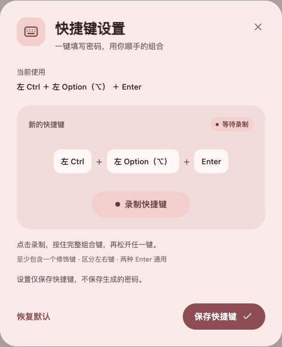

# 快捷随机密码填写

通过自己录制的快捷键，为当前聚焦的输入框生成并填写随机密码。适用于 Tampermonkey（油猴）和 Violentmonkey（暴力猴）。

**[安装用户脚本](https://raw.githubusercontent.com/ZOUYIQAQ/quick-password-entry-js/main/quick-password-entry.user.js)**

当前版本：**1.1.1**。

## 设置页预览

浅色背景为 `#f9ebe9` 的无边框 Material 3 设置弹窗，可直接录制并保存自己的组合键。

## 安装

1. 在浏览器中安装 Tampermonkey 或 Violentmonkey。
2. 点击上面的安装链接，在管理器中确认安装。如果浏览器直接显示源码，可新建脚本并复制 [quick-password-entry.user.js](./quick-password-entry.user.js) 的完整内容保存。
3. 刷新需要使用的网页。

如果所有网页都无法运行，请检查脚本是否启用，以及 Chrome 扩展详情页是否已开启“允许运行用户脚本”。部分旧版本浏览器或管理器使用“开发者模式”控制用户脚本权限，请以管理器提示为准。

## 自己录制快捷键

1. 打开油猴或暴力猴的弹出菜单。
2. 在本脚本的菜单中选择 **设置密码填写快捷键**。
3. 点击 **录制快捷键**，按住想使用的完整组合键，再松开任意一个键。
4. 检查录制结果，点击 **保存快捷键**。

录制区分左右按键，组合至少包含两个键，并包含 Ctrl、Alt / Option、Shift、Command / Win 中的至少一个。支持只有修饰键的组合，也支持修饰键与字母、数字或 Enter 的组合。主键盘 Enter 和数字键盘 Enter 通用。

默认快捷键为 **左 Ctrl ＋ 左 Alt ＋ Enter**。Mac 上 Option（⌥）就是 Alt，Command（⌘）与 Ctrl 是不同的按键；可以直接录制，不必手动填写键名。

快捷键由管理器保存，可在不同网站和已打开的标签页之间同步。Esc 可以取消录制，直接关闭弹窗不会保存草稿；恢复默认也需要点击保存才生效。设置入口仅在管理器菜单中，网页没有额外悬浮按钮。

## 填写规则

- 先聚焦可编辑区域，再按快捷键。
- 默认生成 20 位密码；输入框设置了更短的 `maxlength` 时会遵守其限制，长度不足 4 位时不填写。
- 每次生成都会替换原有内容，不追加。
- 每个页面内成功触发后，交替生成“含特殊符号”和“仅含大小写字母、数字”的密码。页面刷新后从含特殊符号开始。
- 每种启用的字符类别至少出现一次；随机数使用浏览器的 `crypto.getRandomValues`。
- 长按不会连续生成；松开组合中的任意一个键后可再次触发。

## 输入框兼容

支持普通文本框、密码框、邮箱和搜索等文本输入控件、`textarea`、`contenteditable`、开放的 Shadow DOM，以及允许管理器注入脚本的 iframe。

通过原生值 setter 和可冒泡的 `input` / `change` 事件兼容常见 React 受控组件、Vue `v-model` 和 `v-model.lazy`。

只读、禁用、不可编辑控件不会填写。数字、日期等控件如果由浏览器拒绝接受密码，会恢复原值。网页自身的格式校验、特殊富文本编辑器、封闭的 Shadow DOM，以及浏览器内部页面等受限环境，不能保证全部兼容。被操作系统或浏览器提前拦截的快捷键可能无法录制或触发，可换一个组合。

## 界面与数据

设置弹窗采用无边框 Material 3 风格，浅色背景为 `#f9ebe9`，搭配豆沙色按钮，支持系统深色主题和窄屏布局。

脚本仅保存快捷键配置，不保存密码、不读取已有密码进行上传，也不发送网络请求。脚本生成的密码会写入当前网页，网页自身可以读取输入内容。用户脚本管理器可能根据脚本元数据从本仓库检查和下载更新。

## 验证

已使用独立的无头 CloakBrowser 和实际 Violentmonkey 安装环境验证。最新界面版本通过 32 项检查，覆盖录制、保存、取消、恢复默认、跨站同步、左右键、React / Vue 状态同步、默认配色和 320px 窄屏布局。

本仓库仅包含发布脚本及必要文档；浏览器配置、Cookie、测试日志和临时测试文件不在上传范围内。

## 许可证

[MIT](./LICENSE)
